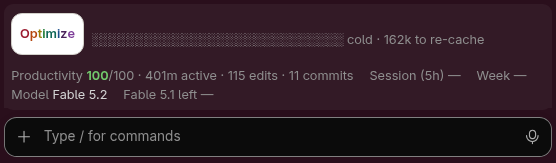
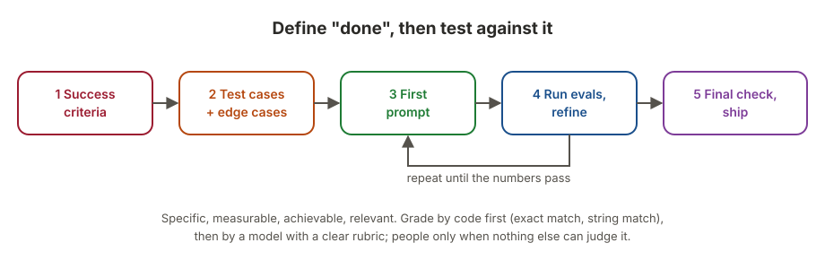

# Success criteria and evals in Optimize

Press **Optimize** and the rewrite now tells Claude Code what "done" means and how to prove it. The rule comes from Anthropic's guide [Define success criteria and build evaluations](https://platform.claude.com/docs/en/test-and-evaluate/develop-tests), which the daily rules update reads alongside the two prompting pages.

## What the guide says, in short

- **Good criteria are specific, measurable, achievable and relevant.** "Classify sentiment well" is too vague to be a target. "F1 of at least 0.85 on a held-out set" works because you can measure it.
- **Most jobs need several criteria at once**, for example accuracy, consistency, tone, privacy, latency and price.
- **Evals mirror the real task, edge cases included:** empty or irrelevant input, very long input, and cases even people would disagree on.
- **Automate the grading, and favour volume.** Many cases graded by code beat a few graded by hand.
- **Grade with the fastest method that is reliable enough:** code first (exact match, string match), then a model judging against a clear rubric with an exact output format and its reasoning switched on, and people only as a last resort.

## What Optimize does with it

Optimize ships with this rule. The daily update rewords it when the page changes:

> Make "done" specific and measurable. When the draft's goal has no finish line ("better", "faster", "more accurate"), ask Claude Code to state the success criteria it will meet and how it will measure them, prefer a check that runs by itself (a test, an exact-match comparison, a script, a number) over judging by eye, and cover the edge cases the draft mentions. Never invent a target figure the draft doesn't give.

It works alongside the rule that already asks for a way to check the work. A target the developer gives is kept exactly as written. Optimize never makes up a number of its own.

Example draft: `make the search ranking more accurate`. Optimize returned:

> Make the search ranking more accurate. First look at how ranking currently works and find any existing tests or example queries that show what "accurate" means here. Then tell me how you'd measure accuracy, for example a set of queries with expected top results, and record a baseline before changing anything. Then make the change and show me the before and after results, plus the output of the existing tests. If it isn't clear what "more accurate" should mean, such as which queries are returning bad results or which signals should matter most, ask me rather than guess. Keep the change to ranking only, with no unrelated cleanup.

It doesn't pick an accuracy target the developer never set.

## Staying current

`GUIDANCE_SOURCES` in [`hooks/guidance-lib.ts`](../hooks/guidance-lib.ts) lists the evals page with the other two. Once a day, when any of the pages changes, Claude brings the rules up to date with them. The page's code samples (`<CodeGroup>`, written in eight languages) are cut out before it is sent. They don't help with wording a prompt, and they are over 90% of the page. `/optimize-rules` shows the rules in use.
